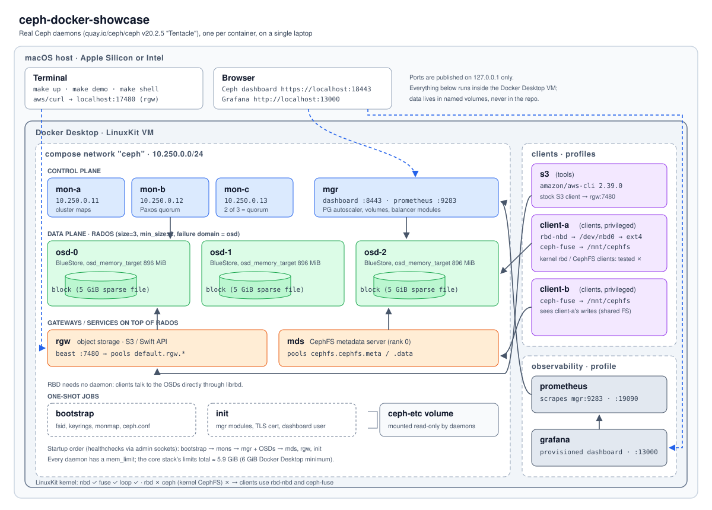
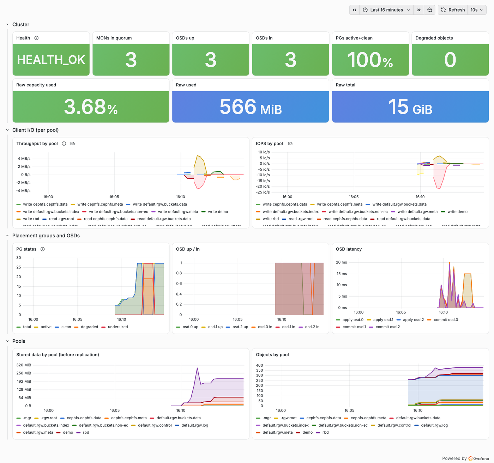
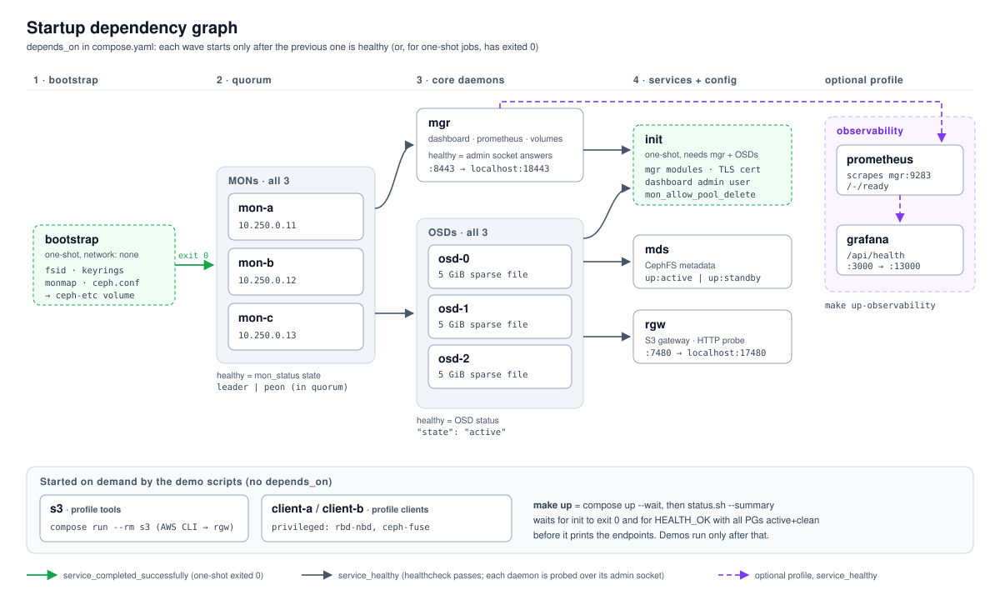

# ceph-docker-showcase

[](https://github.com/elveli/ceph-docker-showcase/actions/workflows/ci.yml)


This repo runs a real, multi-daemon Ceph cluster on one laptop: 3 monitors, a manager with the dashboard,
3 OSDs, a metadata server and an S3 gateway. Each daemon is its own container, built from the official
`quay.io/ceph/ceph` image and orchestrated with plain Docker Compose. `make up` bootstraps the cluster from
nothing in about a minute. `make demo` then walks through Ceph's three storage interfaces:
**object** (S3 via RGW), **block** (RBD) and **file** (CephFS). It also makes data placement (CRUSH)
visible and kills an OSD so you can watch the cluster degrade, keep serving I/O and heal itself.
Nothing is mocked. When something can't work on Docker Desktop (the kernel RBD and CephFS clients), the demo
shows it failing and uses the closest real alternative (`rbd-nbd`, `ceph-fuse`).

It's written for engineers who know containers, Kubernetes and AWS but are new to Ceph. Ceph terms are
explained where they first matter, with AWS analogies where they help. New to the acronyms? Start with
[what RADOS is](#first-what-is-rados) and the [glossary](#glossary).



---

## Contents

- [Quickstart](#quickstart)
- [What the demos show](#what-the-demos-show)
- [Ceph concepts in this repo](#ceph-concepts-in-this-repo) (what RADOS is, plus a glossary)
- [CLI cheat sheet](#cli-cheat-sheet)
- [Design decisions](#design-decisions)
- [Docker Desktop constraints and how they're handled](#docker-desktop-constraints-and-how-theyre-handled)
- [Observability](#observability)
- [Make targets](#make-targets)
- [Repository layout](#repository-layout)
- [What this is not](#what-this-is-not)
- [Tested versions](#tested-versions)
- [Troubleshooting](#troubleshooting)
- [Known limitations](#known-limitations)

---

## Quickstart

Requirements: Docker Desktop on macOS (Apple Silicon or Intel), **at least 6 GB of memory** for Docker
(8 GB with the observability profile), 2+ CPUs and about 10 GB of free disk in the Docker VM. `make preflight`
checks all of this.

```bash
git clone git@github.com:elveli/ceph-docker-showcase.git && cd ceph-docker-showcase
make up        # preflight, bootstrap, start, wait for HEALTH_OK, print endpoints
make demo      # object, block, file, placement, failure (~5 min)
make status    # any time: ceph -s, OSD tree, pools, endpoints
make clean     # delete everything, including all data and generated keys
```

Sample `make up` from a clean state (about 60 s once the image is pulled):

```text
══════════════════════════════════════════════════════════════════
  Preflight
══════════════════════════════════════════════════════════════════
  ✔ architecture x86_64 (Intel/AMD image)
  ✔ running on Docker Desktop
  ✔ memory 15.6 GiB (min 6 GiB)
  ✔ CPUs 16 (min 2)
  ✔ disk 57 GiB free in the Docker VM (min 10 GiB)
  ✔ port 18443 (DASHBOARD) free
  ✔ port 17480 (RGW) free
  ✔ subnet 10.250.0.0/24 available
  ✔ preflight passed
docker compose up -d --wait
  ✔ init job (mgr modules, dashboard user) (after 10s)
  ✔ HEALTH_OK with all PGs active+clean (after 2s)

  $ ceph -s
      cluster:
        id:     f45b0fa2-69d9-41bd-9e2d-4a79e52a338c
        health: HEALTH_OK

      services:
        mon: 3 daemons, quorum a,b,c (age 39s) [leader: a]
        mgr: x(active, since 18s)
        osd: 3 osds: 3 up (since 27s), 3 in (since 35s)
        rgw: 1 daemon active (1 hosts, 1 zones)

      data:
        pools:   5 pools, 5 pgs
        objects: 259 objects, 459 KiB
        usage:   81 MiB used, 15 GiB / 15 GiB avail
        pgs:     5 active+clean

══════════════════════════════════════════════════════════════════
  Endpoints
══════════════════════════════════════════════════════════════════
  Ceph dashboard   https://localhost:18443   (self-signed cert)
                   user: admin   password: Ceph-xxxxxxxxxxxxxx   (random per cluster)
  RGW (S3 API)     http://localhost:17480
  Ceph shell       make shell   (then: ceph -s, ceph osd tree, rados lspools …)
  Demos            make demo    (or demo-object / demo-block / demo-file / demo-failure / demo-placement)
```

The dashboard password is generated at bootstrap and stored only inside the cluster (the mon config-key store).
`make status` prints it again whenever you need it.

The end of `make demo`:

```text
══════════════════════════════════════════════════════════════════
  All demos passed
══════════════════════════════════════════════════════════════════
  ✔ object       40s
  ✔ block        52s
  ✔ file         23s
  ✔ placement    22s
  ✔ failure     103s
```

---

## What the demos show

Every script says what it's about to do and why, runs real commands, shows their output, and **checks
the result**: checksums, health states, cross-client visibility. Any failure stops the script with a non-zero exit.
All demos are idempotent and can be re-run in any order.

| Target | What happens | Proves |
|---|---|---|
| `make demo-object` | Creates an RGW user and bucket with `radosgw-admin`. Uploads 24 MiB with **stock AWS CLI v2** (multipart), then runs ListObjectsV2, HeadObject (multipart ETag, user metadata) and object tagging. Downloads and compares SHA-256, then fetches a **presigned URL from the Mac with curl**. Finally lists the RADOS objects behind the S3 object. | S3 API compatibility. An S3 object is just RADOS objects in a pool. |
| `make demo-block` | Creates a 1 GiB RBD image. **Tries kernel `rbd map` and shows it failing** (no `rbd` module in LinuxKit), then attaches it with **`rbd-nbd`** instead. Runs mkfs.ext4 and writes known data, shows thin provisioning with `rbd du`, snapshots under `fsfreeze`, changes the data, rolls back and verifies the checksums. Ends with an `rbd bench` on a scratch image. | Block devices, thin provisioning, consistent snapshots and rollback. |
| `make demo-file` | Creates a CephFS volume and a least-privilege cephx key (`ceph fs authorize`). **Tries `mount -t ceph` and shows it failing**, then mounts with **`ceph-fuse` on two separate client containers**. client-a writes and client-b reads it with the same checksum. client-b appends and client-a sees it. Maps a file to its RADOS objects via the layout xattr. | A shared POSIX filesystem with coherent multi-client access. |
| `make demo-placement` | `ceph osd map` for several objects (object → PG → `[OSDs]`, primary first), including one that **doesn't exist yet**. Shows a per-PG acting-set table and the CRUSH rule, then uses `crushtool --test` to show that a *host*-level rule gives **1024/1024 bad mappings** on one host, against 0 for the *osd* rule. | Placement is computed, not looked up. Shows why this lab uses failure domain `osd`. |
| `make demo-failure` | Writes 8 objects and records their checksums, then **SIGKILLs the primary OSD** of one of them. Shows `OSD_DOWN` and `PG_DEGRADED` (33% of objects degraded) while **every read verifies and a new write succeeds**. After the 60 s `mon_osd_down_out_interval` the OSD is marked *out*, and the script explains why no backfill happens with 3 OSDs at size=3. Then it restarts the OSD, recovers to **HEALTH_OK** (about 15 s), re-verifies every checksum and deep-scrubs the PG written during the outage (0 inconsistencies). | Availability under failure, and self-healing. |

Excerpt from `make demo-failure` (the final from-scratch run):

```text
▶ Kill osd-0 (SIGKILL, like a crashed daemon)
  $ compose --progress quiet kill osd-0
  ✔ MONs to mark osd.0 down (after 1s)
  ✔ PGs to finish re-peering on the survivors (after 1s)
  ✔ health to report degraded PGs (after 5s)

▶ The cluster is degraded but available
  $ ceph health detail
    HEALTH_WARN 1 osds down; Degraded data redundancy: 375/1125 objects degraded (33.333%), 19 pgs degraded
    [WRN] OSD_DOWN: 1 osds down
        osd.0 (root=default,host=docker-desktop) is down
    [WRN] PG_DEGRADED: Degraded data redundancy: 375/1125 objects degraded (33.333%), 19 pgs degraded
  $ ceph pg stat
    27 pgs: 8 active+undersized, 19 active+undersized+degraded; 152 MiB data, 570 MiB used, 14 GiB / 15 GiB avail; 375/1125 objects degraded (33.333%)

▶ I/O continues: read every object and write a new one
    obj-1: OK
    …
    obj-during-outage: OK
  ✔ all reads verified and a new write succeeded with osd.0 down
    marked out 63s after the kill
…
▶ Bring osd-0 back
    t+  1s  27 pgs: 8 active+undersized, 19 active+undersized+degraded
    t+  8s  27 pgs: 27 active+clean
  ✔ HEALTH_OK 14s after restarting osd.0
  ✔ deep scrub of pg 12.8 (after 4s)
```

Why "down" after only 1 s: SIGKILL makes the kernel close the OSD's sockets, so its peers get
connection-refused and report it straight away (`osd_fast_fail_on_connection_refused`). A host that silently
loses power would be detected by missed heartbeats after `osd_heartbeat_grace` (20 s) instead.

---

## Ceph concepts in this repo

### First, what is RADOS?

**RADOS** (Reliable Autonomic Distributed Object Store) *is* Ceph. Everything else is a client of it.
RADOS is a flat, replicated object store: you put a named blob of bytes into a pool, and it is copied to
several OSDs, kept consistent and repaired when a disk dies, with no central metadata server in the data path.
"Autonomic" means the OSDs do their own replication, failure detection and recovery between each other, so
clients don't. RADOS objects are not S3 objects. They have no HTTP API, buckets or ACLs. Think of RADOS as
the internal key→blob layer underneath three products:

```text
   S3 / Swift apps        VMs, databases          shared POSIX dirs
         │                     │                         │
   RGW (object)          RBD (block)              CephFS (file)  ← + MDS for metadata
         └─────────────────────┼─────────────────────────┘
                     librados (client library)
                               │
        RADOS: MONs (maps) + OSDs (data) + CRUSH (placement)
```

`make demo-placement` and `make demo-failure` use `rados put/get` to talk to RADOS directly, with none of the
layers above it. The object, block and file demos each end by listing the RADOS objects behind an S3 object,
an RBD image or a CephFS file.

### Daemons and core ideas

| Concept | One-line explanation | Runs in |
|---|---|---|
| **MON** (monitor) | Keeps the authoritative cluster maps (who's up, where data goes, auth) and agrees on them by Paxos quorum. 2 of 3 must be alive. | `mon-a`, `mon-b`, `mon-c` |
| **MGR** (manager) | Runs non-critical cluster services as Python modules: dashboard, Prometheus exporter, PG autoscaler, `volumes` (CephFS management). | `mgr` |
| **OSD** (object storage daemon) | Stores the data on one device and handles replication, recovery and scrubbing for its share of PGs. Here each OSD's "device" is a sparse file. | `osd-0`, `osd-1`, `osd-2` |
| **MDS** (metadata server) | Owns the CephFS namespace (directories, inodes, permissions) and hands out capabilities so clients cache coherently. File *data* bypasses it and goes straight to the OSDs. | `mds` |
| **RGW** (RADOS Gateway) | Stateless HTTP gateway that speaks S3 and Swift and stores everything as RADOS objects. A self-hosted S3 endpoint. | `rgw` |
| **RBD** (RADOS Block Device) | A virtual disk striped across 4 MiB RADOS objects, with thin provisioning, snapshots and clones. Ceph's EBS. No daemon: the client library does the striping. | `client-a` via `rbd-nbd` |
| **CephFS** (Ceph File System) | A POSIX filesystem whose metadata lives in the MDS and whose file contents are RADOS objects. Ceph's EFS. | `mds` plus `client-a`/`client-b` via `ceph-fuse` |
| **PG** (placement group) | A shard of a pool. Objects hash into PGs, and Ceph replicates, recovers and peers per PG rather than per object, which keeps the bookkeeping tractable. | Inside the OSDs; see `make demo-placement` |
| **CRUSH** (Controlled Replication Under Scalable Hashing) | The deterministic placement algorithm. Given a PG and the cluster map, it computes the ordered list of OSDs (primary first) and honors failure domains. No lookup table exists. | Computed by every client and daemon |

Also worth knowing: a **pool** is a namespace with its own replication settings and PG count (think of it
as a bucket-of-buckets policy boundary). **cephx** is Ceph's shared-secret auth, with per-identity
capabilities much like scoped IAM policies. **BlueStore** is the OSD backend that writes directly to a raw
block device without a filesystem underneath.

### Glossary

Every Ceph term and acronym used in this repo, A–Z.

| Term | Meaning |
|---|---|
| **active+clean** | The healthy PG state: the PG is serving I/O (*active*) and every replica is present and up to date (*clean*). `HEALTH_OK` needs all PGs here. |
| **admin socket** (`.asok`) | A per-daemon Unix socket under `/var/run/ceph/` that answers local queries such as `status` and `config show` without going through the MONs. The healthchecks use it. |
| **backfill** | Copying a whole PG to an OSD that didn't have it before, after CRUSH moved it. Compare *recovery*. |
| **BlueStore** | The OSD storage backend. It manages a raw block device (here a sparse file) directly, with RocksDB for metadata. |
| **caps** | Capabilities. In cephx they're the permissions on a key (`mon 'allow r', osd 'allow rw pool=x'`). In CephFS they're the MDS-granted leases that let clients cache file state. |
| **CephFS** | Ceph File System. See above. |
| **cephx** | Ceph's authentication protocol: shared secret keys plus per-entity caps. Entities are named like `client.admin`, `osd.0` and `mon.`. |
| **config-key** | A small key/value store kept by the MONs. This repo keeps the generated dashboard password there (`showcase/dashboard-password`) so it's never written to the repo. |
| **CRUSH** | Controlled Replication Under Scalable Hashing. See above. The **CRUSH map** is the hierarchy (root → host → osd) plus the rules that walk it. |
| **degraded** | Fewer up-to-date copies exist than `size`, but I/O continues while at least `min_size` are available. |
| **EC** (erasure coding) | An alternative to replication: data is split into k data chunks plus m parity chunks. Not used here, because it needs more OSDs than 3. |
| **failure domain** | The CRUSH bucket type that replicas must not share (`host`, `rack`, …). This repo uses `osd` because there's only one host; see [Design decisions](#design-decisions). |
| **FUSE** | Filesystem in Userspace. `ceph-fuse` implements CephFS in a user process because the Docker Desktop kernel has no `ceph` module. |
| **fsid** | The cluster's UUID, generated once by `bootstrap`. Every daemon and client checks it. |
| **HEALTH_OK / WARN / ERR** | The cluster's overall health summary (`ceph health`). `ceph health detail` says why. |
| **keyring** | A file holding one or more cephx keys, for example `/etc/ceph/ceph.client.admin.keyring`. Generated at runtime and never committed. |
| **librados / librbd** | Client libraries that every Ceph client links against: one for RADOS objects, one for RBD images. |
| **LinuxKit** | The minimal Linux VM that Docker Desktop runs containers in. Its kernel decides which Ceph clients can work (NBD and FUSE yes, `rbd`/`ceph` modules no). |
| **MDS / MGR / MON / OSD** | The daemons. See above. |
| **min_size** | The minimum number of replicas that must be available for a PG to accept I/O (2 here). Below that the PG blocks rather than risk divergence. |
| **monmap** | The list of MONs (names and addresses) plus the fsid. Built by `bootstrap` with `monmaptool`. |
| **NBD** | Network Block Device, a kernel facility that `rbd-nbd` uses to expose an RBD image as `/dev/nbdX`. |
| **out** | An OSD excluded from CRUSH placement. A *down* OSD becomes *out* after `mon_osd_down_out_interval` (60 s here). |
| **Paxos** | The consensus algorithm the MONs use to agree on each new version of the cluster maps. |
| **peering** | Replicas of a PG agreeing on its authoritative history after any change in membership. I/O to that PG pauses briefly. |
| **PG** | Placement group. See above. |
| **pool** | A logical partition of RADOS with its own `size`, `min_size`, PG count and CRUSH rule. |
| **primary** | The first OSD in a PG's acting set. Clients send it all reads and writes, and it fans writes out to the replicas. |
| **RADOS** | Reliable Autonomic Distributed Object Store. See [First, what is RADOS?](#first-what-is-rados). |
| **RBD** | RADOS Block Device. See above. |
| **recovery** | Bringing a returning OSD up to date by replaying only the objects that changed while it was away (from the PG log). |
| **RGW** | RADOS Gateway. See above. |
| **scrub / deep scrub** | Background consistency checks. A scrub compares metadata across replicas; a deep scrub reads and checksums every byte. |
| **size** | The number of replicas per object (3 here). |
| **Tentacle** | The codename of Ceph release 20.x. Releases are named alphabetically after cephalopods (Reef 18, Squid 19, Tentacle 20). |
| **undersized** | A PG with fewer OSDs in its acting set than `size`, because CRUSH can't find enough eligible OSDs. This happens with 3 OSDs and one out. |

---

## CLI cheat sheet

Run these inside `make shell`, which opens bash in `mon-a` with the admin keyring. Pool, image, bucket and user
names match what `make demo` creates. Every command here was run against this cluster. Most read-only commands
accept `-f json-pretty`.

### Cluster health: start here

| Command | What it tells you |
|---|---|
| `ceph -s` | One-screen summary: health, MON quorum, MGR, OSDs up/in, PG states, capacity, client I/O. |
| `ceph health detail` | *Why* the cluster isn't HEALTH_OK, one line per affected PG/OSD/daemon. |
| `ceph -w` | `ceph -s`, then a live stream of the cluster log (Ctrl-C to stop). Run it during `make demo-failure`. |
| `ceph df` | Raw capacity, plus per-pool stored bytes vs. used bytes. Used is roughly stored × `size`. |
| `ceph osd df tree` | Per-OSD fill level, PG count and variance, laid out as the CRUSH tree. |
| `ceph versions` | Which Ceph version each daemon runs. Useful during upgrades. |
| `ceph crash ls` | Daemon crash reports collected by the `crash` module. |

### MONs, MGR and OSDs

| Command | What it tells you |
|---|---|
| `ceph mon stat` | MON addresses, current leader and quorum members. |
| `ceph quorum_status -f json-pretty` | The full quorum view, including election epoch and the monmap. |
| `ceph mgr services` | URLs exposed by MGR modules (dashboard, Prometheus). These are container-internal addresses. |
| `ceph mgr module ls` | Which MGR modules are on, off, or always on. |
| `ceph osd tree` | The CRUSH hierarchy, with each OSD's up/down and weight. |
| `ceph osd stat` | Counts: how many OSDs exist, are up, and are in. |
| `ceph osd set noout` / `ceph osd unset noout` | Stop down OSDs from being marked out (and data from moving). Set it before planned maintenance. |
| `ceph osd out 1` / `ceph osd in 1` | Manually take an OSD out of data placement, or put it back. |
| `ceph daemon mon.a mon_status` | Ask a daemon directly over its admin socket. This only works in the container running that daemon. |
| `ceph tell osd.0 version` | Send a command to a remote daemon through the cluster, from anywhere. |

### Pools, PGs and placement

| Command | What it tells you |
|---|---|
| `ceph osd pool ls detail` | Every pool with its `size`, `min_size`, PG count, CRUSH rule and application. |
| `ceph osd pool get rbd size` | One pool setting. `set` changes it, for example `ceph osd pool set demo size 2`. |
| `ceph osd pool autoscale-status` | What the PG autoscaler thinks each pool's PG count should be. |
| `ceph osd map demo obj-1` | Where an object lives: the PG it hashes to, and the ordered OSD list (primary first). No lookup involved. |
| `ceph pg stat` | One-line PG state summary, such as `X pgs: X active+clean`. |
| `ceph pg dump pgs_brief` | Every PG with its up/acting OSD sets and primary. |
| `ceph pg 12.3 query` | Everything about one PG: peering history, last scrub, recovery state. |
| `ceph pg deep-scrub 12.3` | Ask for a byte-for-byte replica comparison of one PG now. |
| `ceph osd crush rule dump replicated_rule` | The steps CRUSH follows, here `take default` → `choose_firstn … type osd` → `emit`. |

### Config and auth

| Command | What it tells you |
|---|---|
| `ceph config dump` | Everything set in the MONs' central config database. Includes secrets, such as the dashboard's RGW keys. |
| `ceph config get osd osd_memory_target` | The value in the central database. |
| `ceph config show osd.0 osd_memory_target` | The value the daemon is *actually running with*. Here it differs from `config get`, because the 896 MiB setting comes from `ceph.conf`, which the central database doesn't see. |
| `ceph config set osd debug_osd 5/5` | Change a setting cluster-wide at runtime. `ceph config rm osd debug_osd` reverts it. |
| `ceph auth ls` | Every cephx identity and its caps. This prints secret keys. |
| `ceph auth get client.admin` | One identity's key and caps, in keyring format. |

### RADOS: raw objects

| Command | What it does |
|---|---|
| `rados lspools` | List pools. |
| `rados df` | Per-pool object counts, copies, degraded/missing objects and I/O totals. |
| `rados -p demo ls` | List the objects in a pool. |
| `rados -p demo put myobj /etc/hosts` / `rados -p demo get myobj -` | Write a file as an object, and read it back to stdout. |
| `rados -p demo stat obj-1` | An object's size and mtime. |
| `rados -p demo rm myobj` | Delete an object. |

### RBD: block devices

| Command | What it does |
|---|---|
| `rbd ls -l rbd` | Images and snapshots in the `rbd` pool, with sizes. |
| `rbd info rbd/demo-disk` | Size, object size (4 MiB), features, and `block_name_prefix`, the prefix of its RADOS objects. |
| `rbd du rbd/demo-disk` | Provisioned vs. actually used space. Thin provisioning in action. |
| `rbd snap ls rbd/demo-disk` | Snapshots. `rbd snap create rbd/demo-disk@name` makes one, and `rbd snap rollback` reverts to it. |
| `rbd create rbd/disk2 --size 1G` / `rbd rm rbd/disk2` | Create or delete an image. Map it from `client-a` with `rbd-nbd map`, as `demo-block.sh` does. |

### CephFS

| Command | What it tells you |
|---|---|
| `ceph fs ls` | Filesystems and their metadata and data pools. |
| `ceph fs status` | MDS ranks, active vs. standby, client count, and pool usage. |
| `ceph mds stat` | One-line MDS state, for example `cephfs:1 {0=a=up:active}`. |
| `ceph fs volume ls` / `ceph fs subvolume ls cephfs` | Volumes and subvolumes managed by the `volumes` MGR module. This is the API that Kubernetes CSI uses. |
| `ceph fs authorize cephfs client.x / rw` | Create a key limited to one filesystem and path. Fetch it afterwards with `ceph auth get client.x`. |

### radosgw-admin: S3 users, buckets and objects

`radosgw-admin` talks to RADOS directly, not through RGW's HTTP API. It is the admin tool for things S3
itself can't do: users, keys, quotas and internals.

| Command | What it does |
|---|---|
| `radosgw-admin user list` | List RGW users. `dashboard` is created by the dashboard's Object pages, and `demo` by `make demo-object`. |
| `radosgw-admin user info --uid=demo` | A user's access/secret keys, caps and quotas. This prints secrets. |
| `radosgw-admin user create --uid=alice --display-name="Alice"` | Create a user and generate an S3 key pair. |
| `radosgw-admin key create --uid=alice --gen-access-key --gen-secret` | Add another key pair, for rotation. `key rm --access-key=…` removes one. |
| `radosgw-admin user stats --uid=demo --sync-stats` | Bytes and object counts used by a user. |
| `radosgw-admin quota set --quota-scope=user --uid=demo --max-size=1G` | Set a quota, then turn it on with `radosgw-admin quota enable --quota-scope=user --uid=demo`. |
| `radosgw-admin bucket list` | All buckets. With `--bucket=showcase` it lists that bucket's objects instead. |
| `radosgw-admin bucket stats --bucket=showcase` | Owner, size, object count, index shards and placement. |
| `radosgw-admin object stat --bucket=showcase --object=sample.bin` | An object's size, ETag, metadata and manifest (how it is split into RADOS objects). |
| `radosgw-admin bucket radoslist --bucket=showcase` | The RADOS object names behind every S3 object in the bucket. |
| `radosgw-admin gc list` | RADOS objects waiting for garbage collection after an S3 delete. Space is freed asynchronously. |
| `radosgw-admin zonegroup get` / `zone get` | Multisite topology. Here that's the single `default` zonegroup and zone. |

Not available here: `ceph orch …`. Its orchestrator backends (cephadm, Rook) aren't used in this repo,
because Compose plays that role. See [Why Docker Compose, not cephadm or Rook](#why-docker-compose-not-cephadm-or-rook).

---

## Design decisions

### Why Docker Compose, not cephadm or Rook

- **Compose (chosen):** Ceph daemons are ordinary processes and run fine in containers given stable IPs and shared config. Compose adds explicit ordering, healthchecks and named volumes, and nothing else.
- **cephadm:** expects systemd and SSH-reachable hosts and drives its own `podman`/`docker run` calls. Inside Docker Desktop that would mean Docker-in-Docker around systemd: fragile and opaque.
- **Rook on kind:** adds Kubernetes, the operator, CSI and many CRDs, roughly doubling memory. It still needs block devices for OSDs, and its RBD/CephFS CSI path wants kernel clients that LinuxKit lacks. It's a good next step, not a good base.
- **The legacy `ceph/daemon` image is dead:** last pushed May 2024, Reef only. `quay.io/ceph/ceph` is the official image and ships every daemon plus `rbd-nbd` and `ceph-fuse`.

### Release pin

`quay.io/ceph/ceph:v20.2.5` (**Tentacle**), pinned by multi-arch index digest, with both `linux/amd64` and
`linux/arm64` images. When this repo was built (2026-11), the active releases were Umbrella 21.2.0
(released 5 days earlier), Tentacle 20.2.5 and Squid 19.2.7 (EOL 2026-10-31). Tentacle is the mature
current line, while a `.0` release is too fresh to call "tested". Override with `CEPH_IMAGE` in `.env`.

### OSDs without disks: file-backed BlueStore

Each OSD uses **BlueStore on a 5 GiB sparse file** inside its named volume, set with `bluestore_block_create = true` and
`bluestore_block_size`. The OSD is created with `ceph osd new` + `ceph-osd --mkfs`, the same low-level path
`ceph-volume` uses internally, minus LVM. No loop devices, no LVM, no `ceph-volume`, no privileges.
Real usage is only what's written (about 80 MiB raw across all three OSDs after bootstrap).

### Bootstrap and secrets

A one-shot `bootstrap` container generates the fsid, every keyring, the monmap and `ceph.conf` into the
`ceph-etc` volume. It's idempotent: if `ceph.conf` exists it does nothing. Files are built in a scratch dir and
`ceph.conf` is moved in last, so a crash halfway through leaves nothing behind. The mon keyring carries all
bootstrap identities with their caps, and `ceph-mon --mkfs` imports them into the auth database, so there's no
post-start `ceph auth` race. Daemons mount the volume **read-only**. **No secret is ever written to the repo.**
The dashboard password lives in the mon config-key store, and the demo's CephFS key is issued at runtime.

### Startup ordering and health

`bootstrap` (must complete) → `mon-a/b/c` (healthy) → `mgr` + `osd-0/1/2` (healthy) → `mds`, `rgw`, `init`.
Healthchecks ask each daemon over its **admin socket**: a mon must be `leader`/`peon`, an OSD `active`,
an MDS `up:*`. RGW is checked over HTTP. They poll every 2 s during startup and every 30 s after that,
because each check spawns the Python `ceph` CLI. `make up` also waits for the `init` job and HEALTH_OK
before printing endpoints. See the [startup dependency graph](docs/startup-dependencies.svg).

### Networking

Mons need fixed addresses, since the monmap stores them. The Compose network is `10.250.0.0/24` with mons at
`.11–.13`, and dynamic container IPs are fenced into `.128/25` (`ip_range`) so they can never collide.
Published ports bind to `127.0.0.1` only.

### Replication and failure domain: lab vs production

Pools use `size=3, min_size=2`: three copies, and I/O continues while two are available. The CRUSH failure domain is
**`osd`** (`osd_crush_chooseleaf_type = 0`), and all OSDs are placed under one CRUSH host bucket,
`docker-desktop`, because that's the truth: they share one machine.

In production the failure domain is **`host`** (or `rack`/`row`), so no two replicas share a server, PSU
or top-of-rack switch. Here a host rule can't place 3 replicas on 1 host; `make demo-placement` shows
crushtool returning 1024/1024 bad mappings. The `osd` domain protects against losing one OSD process or disk,
which is exactly what the failure demo simulates.

One non-obvious consequence, found while building this: the mons only accept "OSD X is down" once reports
come from `mon_osd_min_down_reporters` (2) **distinct subtrees** at `mon_osd_reporter_subtree_level`
(default `host`). With one host bucket the two surviving OSDs count as *one* reporter, so a killed OSD went
unnoticed until the 900 s beacon timeout. The fix is `mon_osd_reporter_subtree_level = osd`. A real
cluster with several hosts never hits this.

### Resource sizing

| Service | `mem_limit` | Measured after `make demo` | Key settings |
|---|---|---|---|
| mon ×3 | 384 MiB each | 43–50 MiB | — |
| mgr | 768 MiB | 182 MiB | dashboard + prometheus modules |
| osd ×3 | 1 GiB each | 74–91 MiB | `osd_memory_target = 896 MiB` (the enforced minimum) |
| mds | 512 MiB | 32 MiB | `mds_cache_memory_limit = 256 MiB` |
| rgw | 512 MiB | 102 MiB | `rgw_thread_pool_size = 64` |
| **core total** | **≈ 5.9 GiB** | **≈ 0.7 GiB** | |
| prometheus / grafana (optional) | 256 / 512 MiB | 46 / ~210 MiB | 2-day retention |

The limits are ceilings, not reservations. **Minimum Docker Desktop memory: 6 GB** (8 GB recommended with
observability). `osd_memory_target` can't go below 896 MiB; it caps BlueStore caches and isn't a
working-set size.

---

## Docker Desktop constraints and how they're handled

Everything runs inside Docker Desktop's **LinuxKit VM** (kernel `7.0.14-linuxkit` at test time), not on macOS.
These are the constraints that shaped the design. Each was verified empirically, not assumed.

| Constraint | Impact | How the design handles it |
|---|---|---|
| **LinuxKit VM**: containers share one small, fixed kernel; no module loading (`modprobe` finds no modules) | Only features built into the kernel are usable | Probed the kernel config: `CONFIG_BLK_DEV_NBD=y`, `CONFIG_FUSE_FS=y`, `CONFIG_BLK_DEV_LOOP=y`; **no** `CONFIG_BLK_DEV_RBD`, **no** `CONFIG_CEPH_FS`. Clients use the userspace paths built on NBD and FUSE. |
| **No real block devices** | OSDs normally consume whole disks via `ceph-volume`/LVM | File-backed BlueStore (`bluestore_block_create`) on sparse files in named volumes. No disks, LVM or privileges. |
| **Loop devices / privileged containers** | Loop devices exist but are shared VM-wide; privileged containers can affect every other container | OSDs don't use loop devices and run **unprivileged**. Only the optional `client-a`/`client-b` are privileged, because `rbd-nbd` needs `/dev/nbd*` + `mount` and `ceph-fuse` needs `/dev/fuse`. The block demo always unmaps its NBD device, even when interrupted (`trap`). |
| **No kernel RBD client** | `rbd map` fails: `Module rbd not found in directory /lib/modules/7.0.14-linuxkit` | The demo **runs `rbd map` and shows the failure**, then uses `rbd-nbd` (librbd in userspace exposed via the kernel NBD driver): a real block device with ext4 on it. |
| **No kernel CephFS client** | `mount -t ceph` fails: `ceph filesystem not supported by the system` | The demo shows the failure, then uses `ceph-fuse` on two clients. |
| **Memory** (Docker Desktop default is often 2–4 GB, shared with everything else) | Ceph's defaults (e.g. 4 GiB `osd_memory_target`) would OOM the VM | Explicit small settings, a `mem_limit` on every service, Prometheus/Grafana in an opt-in profile, and `make preflight` refuses to start below 6 GB. |
| **Shared disk** (the VM disk holds every image and volume on the laptop) | The mon warns at < 30 % free space by default, which is common on a dev laptop | `mon_data_avail_warn = 10`, and preflight checks for ≥ 10 GiB free inside the VM. |
| **Bind mounts go through virtiofs** | Slow, and semantics differ from a local FS (O_DIRECT, fsync) | All Ceph data lives in **named volumes** on the VM's ext4. Bind mounts are only used for read-only scripts and config. |
| **macOS ships bash 3.2** | Bash 4+ features break the host scripts | Host scripts avoid bash 4 features and were run under `/bin/bash` 3.2. |

---

## Observability

```bash
make up-observability   # cluster + Prometheus + Grafana (needs ~8 GB for Docker)
```

The mgr's `prometheus` module (enabled at init, port 9283) is scraped by Prometheus. Grafana starts with a
provisioned **"Ceph showcase · cluster overview"** dashboard: health, quorum, OSD up/in, PG states,
degraded objects, capacity, per-pool throughput/IOPS/stored bytes and OSD latency. Anonymous users get
read-only access; `admin`/`admin` can edit (it's bound to localhost).

| | URL |
|---|---|
| Grafana | http://localhost:13000 |
| Prometheus | http://localhost:19090 |
| Ceph dashboard | https://localhost:18443 (always on, not part of the profile) |

The screenshot below was taken right after `make demo`. The PG-state and OSD panels show the failure demo
(degraded/undersized PGs, osd.0 down, then recovery):



Since Reef, per-daemon performance counters (such as per-OSD op rates) are exported by the separate
`ceph-exporter` daemon, not the mgr. This repo doesn't run it, so throughput and IOPS are shown per pool.

---

## Make targets

| Target | Description |
|---|---|
| `make up` | Preflight, then start the cluster (bootstraps on first run), wait for HEALTH_OK, print endpoints |
| `make up-observability` | `up` plus Prometheus + Grafana |
| `make down` | Stop all containers; data is kept |
| `make clean` | Stop everything and **delete all data and generated secrets** |
| `make status` | `ceph -s`, OSD tree, pools, containers, endpoints and dashboard password |
| `make demo` | All demos in order: object, block, file, placement, failure |
| `make demo-object` / `demo-block` / `demo-file` / `demo-placement` / `demo-failure` | Individual demos |
| `make shell` | Bash in `mon-a` with the `ceph` CLI and admin keyring |
| `make logs` | Follow logs; `make logs S=osd-0` for one service |
| `make preflight` | Check memory, CPU, architecture, VM disk, ports and subnet |
| `make lint` | shellcheck + `docker compose config` for every profile |

Configuration: copy `.env.example` to `.env` to change ports, the subnet or image pins. Both Compose and the
scripts read it.

---

## Repository layout

```text
.
├── .github/
│   └── workflows/
│       └── ci.yml                  # shellcheck + compose config + full smoke test (amd64)
├── docker/
│   ├── aws/
│   │   └── config                  # AWS CLI profile for RGW (path-style addressing)
│   ├── ceph/
│   │   └── entrypoint.sh           # one entrypoint for every role: bootstrap|mon|mgr|osd|mds|rgw|init|health
│   ├── grafana/
│   │   ├── dashboards/
│   │   │   └── ceph-overview.json  # provisioned dashboard
│   │   └── provisioning/
│   │       ├── dashboards/
│   │       │   └── ceph.yml
│   │       └── datasources/
│   │           └── prometheus.yml
│   └── prometheus/
│       └── prometheus.yml          # scrapes mgr:9283
├── docs/
│   ├── architecture.svg
│   ├── startup-dependencies.svg    # compose depends_on graph
│   └── grafana.png
├── scripts/
│   ├── lib.sh                      # shared helpers: step/run/check output, ceph wrappers, waits
│   ├── preflight.sh                # memory, CPU, arch, disk, ports, subnet
│   ├── status.sh                   # ceph -s + endpoints; waits for readiness after `make up`
│   ├── demo.sh                     # runs all demos, prints a summary
│   ├── demo-object.sh              # RGW + AWS CLI
│   ├── demo-block.sh               # RBD via rbd-nbd, snapshot + rollback
│   ├── demo-file.sh                # CephFS via ceph-fuse on two clients
│   ├── demo-placement.sh           # PGs, CRUSH, crushtool
│   └── demo-failure.sh             # kill an OSD, degrade, recover
├── .env.example                    # overridable ports, subnet, image pins
├── compose.yaml                    # the whole cluster, plus clients/tools/observability profiles
├── LICENSE
├── Makefile
└── README.md
```

Startup dependency graph, as encoded in `compose.yaml`:



---

## What this is not

- **Not for real data.** Every OSD lives on the same disk, in the same VM, on the same laptop. Three
  replicas of nothing-in-particular is still nothing in particular.
- **Not production topology.** Production uses failure domain `host`/`rack`, dedicated disks (NVMe/HDD
  with ceph-volume/LVM), separate public and cluster networks, at least 4 GiB per OSD, and an
  orchestrator (cephadm or Rook) for upgrades, placement and day-2 operations.
- **Not tuned or benchmarked.** Shortened timers (`mon_osd_down_out_interval = 60` vs 600), minimal memory
  targets and sparse-file OSDs on a VM make `rbd bench` numbers meaningless for capacity planning.
- **Not hardened.** The admin keyring is shared across containers through one volume, Grafana allows
  anonymous viewing, the dashboard uses a self-signed cert, and the client containers are privileged.
  All ports bind to localhost only.
- **Not an orchestrator.** There's no upgrade path, no daemon placement and no scaling. Adding a 4th OSD means
  adding a service.

---

## Tested versions

| Component | Version |
|---|---|
| Ceph image | `quay.io/ceph/ceph:v20.2.5` (Tentacle, CentOS Stream 9), digest `sha256:4337ac8a…` |
| AWS CLI image | `amazon/aws-cli:2.39.0` |
| Prometheus / Grafana | `prom/prometheus:v3.15.1` / `grafana/grafana:13.2.5` |
| Docker Desktop VM | kernel `7.0.14-linuxkit`, 16 CPUs / 15.6 GiB |
| Docker Compose | v5.6.1 |
| Host | macOS 26 (Darwin 25.6), **Intel x86_64**; bash 5.3 and macOS `/bin/bash` 3.2 |
| CI | GitHub Actions `ubuntu-latest` (amd64): lint + full `make up && make demo` |

**Apple Silicon:** the pinned image index includes `linux/arm64`, and nothing in the repo is
architecture-specific (no emulation, no amd64-only images). The full end-to-end run above was done on an
Intel Mac, so arm64 is expected to work but hasn't been run end to end yet.

---

## Troubleshooting

| Symptom | Fix |
|---|---|
| `preflight: Docker has X GiB memory` | Docker Desktop → Settings → Resources → Memory ≥ 6 GB (8 GB for observability). |
| `port 18443 (DASHBOARD) is in use` | Set `DASHBOARD_PORT` (or `RGW_PORT`, `PROMETHEUS_PORT`, `GRAFANA_PORT`) in `.env`. |
| `subnet 10.250.0.0/24 is already used` | Set `CEPH_NET_PREFIX=10.251.0` in `.env`, then `make clean && make up`. The monmap stores the mon IPs. |
| `mon-a is unhealthy` straight after `make up`, and the mon log says `reached concerning levels of available storage space` | The disk holding Docker's volumes is below 5% free, so `ceph-mon` exits (code 28, ENOSPC). Free space as in the next row. `make preflight` checks for at least 10 GiB free. |
| `HEALTH_WARN … mon … low on available space` | The Docker VM disk is nearly full: `docker system prune`, or raise the disk limit. |
| A demo was interrupted (Ctrl-C) | Re-run it; every demo is idempotent. The failure demo restarts the killed OSD on exit, and the block demo unmaps its NBD device. |
| Containers stuck in `starting` | `make logs S=mon-a` (or another service). A full reset is `make clean && make up`. |
| Dashboard password | `make status`, or `docker compose exec mon-a ceph config-key get showcase/dashboard-password`. |
| Need the raw Ceph CLI | `make shell`, then `ceph -s`, `ceph osd df`, `ceph pg dump pgs_brief`, `rados df`, `rbd ls -l`. |
| http://localhost:17480 in a browser shows XML with `<ID>anonymous</ID>` and an empty `<Buckets/>` | Expected. Port 17480 is the raw S3 API, not a web UI. An unsigned browser request is treated as the `anonymous` user, which owns no buckets. The demo bucket `showcase` belongs to the RGW user `demo`. To browse it, use the dashboard (**Object → Buckets**) or run `make shell` then `radosgw-admin bucket list`. To use the S3 API from the Mac, export the demo user's keys (`radosgw-admin user info --uid=demo`) and run `aws --endpoint-url http://localhost:17480 s3 ls s3://showcase`. Only presigned URLs, like the one `make demo-object` prints, open directly in a browser. |
| `rgw: 2 daemons active` right after a re-`up` | A recreated RGW's old session lingers for a few minutes and then disappears. Harmless. |

---

## Known limitations

- **No kernel clients.** `rbd map` and `mount -t ceph` can't work on Docker Desktop (the LinuxKit kernel has no
  `rbd`/`ceph` modules). The demos use `rbd-nbd` and `ceph-fuse`, which are real but slower userspace paths.
  On a Linux host with those modules loaded, the demos detect that the kernel client works and carry on.
- **`rbd device list -t nbd` shows nothing inside a container.** It matches PIDs from sysfs, which belong
  to the VM's PID namespace, not the container's. The demo tracks its own mapping instead.
- **No backfill after an OSD is marked out.** With exactly 3 OSDs and size=3 there's no spare failure domain,
  so PGs stay `undersized` until the OSD returns. This is expected, and the failure demo explains it.
  Add a 4th OSD service to watch automatic re-replication.
- **One MDS, no standby.** The CephFS filesystem is unavailable while `mds` restarts.
- **One RGW, no load balancer, plain HTTP.**
- **NBD devices are VM-global.** A privileged client killed mid-demo can leave `/dev/nbdX` busy until
  Docker Desktop restarts. Run the block demo again to clean up its own device.
- **Per-daemon perf counters** need `ceph-exporter`, which isn't deployed here; Grafana shows pool-level I/O.
- **GitHub Actions smoke test** runs on amd64 only. The Ubuntu kernel *has* the rbd/ceph modules, but
  containers can't load them, so the same userspace paths are exercised there.

---

## License

[MIT](LICENSE)
